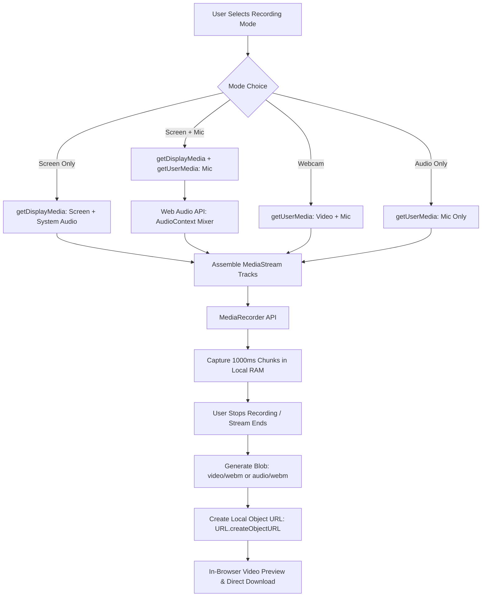

<div align="center">

# 🎥 ScreenRecord

### **Free, Private, In-Browser Screen & Audio Recording**

A modern, 100% client-side web application for recording your screen, application windows, browser tabs, webcam, and microphone. Zero software installations, zero browser extensions, zero watermarks, and zero server uploads.

[](https://screenrecord.github.io/)
[](https://github.com/screenrecord/screenrecord.github.io/actions)
[](https://astro.build)
[](https://react.dev)
[](https://tailwindcss.com)
[](https://opensource.org/licenses/MIT)

<br/>

[](#-internationalization-i18n)
[](https://nodejs.org)
[](#-privacy--security-model)
[](#-technical-seo--performance)

<br/>


</div>

---

## 📑 Table of Contents

- [Overview](#-overview)
- [Key Features](#-key-features)
- [Privacy & Security Model](#-privacy--security-model)
- [How It Works (Architecture Pipeline)](#-how-it-works)
- [Recording Modes](#-recording-modes)
- [Internationalization (i18n)](#-internationalization-i18n)
- [Tech Stack](#-tech-stack)
- [Browser Compatibility](#-browser-compatibility)
- [Project Structure](#-project-structure)
- [Getting Started](#-getting-started)
  - [Prerequisites](#prerequisites)
  - [Installation](#installation)
  - [Development Server](#development-server)
  - [Building for Production](#building-for-production)
- [Technical SEO & Performance](#-technical-seo--performance)
- [CI/CD & Deployment](#-cicd--deployment)
- [Contributing](#-contributing)
- [Support the Developer](#-support-the-developer)
- [License](#-license)

---

## 🌟 Overview

Most screen recording solutions require installing bulky desktop software, registering paid subscriptions, or adding intrusive browser extensions that demand broad device permissions.

**ScreenRecord** eliminates these friction points. It leverages modern, standard Web APIs (`MediaDevices.getDisplayMedia`, `MediaDevices.getUserMedia`, `MediaRecorder`, and the `Web Audio API`) to record video and audio streams directly within your browser window. All video chunks are accumulated purely in local volatile memory (RAM) and converted to an instant downloadable file via an Object URL.

**Nothing is ever uploaded to a server or external cloud.**

---

## 🚀 Key Features

- 🔒 **100% Client-Side Privacy:** Zero network egress for your media streams. Recording, audio mixing, and file compilation occur strictly on your machine.
- 🎬 **4 Flexible Capture Modes:** Full display, window, browser tab, webcam, and microphone voiceovers.
- 🎛️ **Dual-Stream Audio Mixing:** Combines system audio from screen sharing with your microphone input via the Web Audio API without phase cancellation or echo loops.
- 🌍 **Full Internationalization (i18n):** Native support for 6 global languages with automatic subpath routing and dynamic hreflang sitemaps.
- 🌓 **Instant Dark & Light Theme:** System-preference aware mode with an anti-FOUC (Flash of Unstyled Content) inline script.
- ⚡ **Zero Installation:** Works immediately on any modern browser. No accounts, sign-ups, or plugins required.
- 🚫 **No Watermarks & Unlimited Length:** Clean, full-resolution recordings without branding overlays or artificial paywalled duration caps.
- ⏱️ **Full Playback Controls:** Real-time recording timer, pause/resume capability, live preview stream, and instant video download.
- 📱 **Mobile & Desktop Responsive:** Fluid UI built with Tailwind CSS v4, accessible with full ARIA semantics.

---

## 🔒 Privacy & Security Model

Your confidentiality is fundamental to ScreenRecord's architecture:

| Property | ScreenRecord Implementation |
| :--- | :--- |
| **Server Uploads** | **None.** No video, audio, or frame data is ever transmitted over the network. |
| **Data Storage** | Streams are buffered in transient JavaScript arrays in your device's memory (RAM). |
| **Data Cleanup** | When clicking "Record Again" or closing the page, memory blobs are revoked via `URL.revokeObjectURL()` and hardware tracks are formally released. |
| **Telemetry & Cookies** | Privacy-first analytics only (standard anonymized Google Analytics / gtag). No session tracking, no cookies storing media data. |
| **Permissions** | Capture access is prompted natively by your operating system and browser dialogs; permissions are active only during recording. |

---

## 🔄 How It Works



1. **Stream Acquisition:** The browser requests permissions using `navigator.mediaDevices`.
2. **Audio Composition:** In "Screen + Mic" mode, an `AudioContext` destination merges display audio tracks with microphone audio tracks into a unified synchronized audio stream.
3. **Codec Negotiation:** `MediaRecorder` automatically queries `isTypeSupported()` to negotiate the highest quality supported codec (VP9/Opus, VP8/Opus, WebM, MP4).
4. **Buffer & Export:** Chunks arrive in 1-second slices into memory. On completion, the binary array is wrapped in a `Blob`, providing a direct download link without server round-trips.

---

## 🎙️ Recording Modes

| Mode | Input Sources | Best For | Output Format |
| :--- | :--- | :--- | :--- |
| **Screen** | Screen, window, or tab + system audio | Software demos, game capture, streaming | `video/webm` or `video/mp4` |
| **Screen + Mic** | Display stream merged with microphone input | Tutorials, presentations, code walkthroughs | `video/webm` or `video/mp4` |
| **Webcam** | Front-facing camera + microphone | Video memos, vlogs, direct messages | `video/webm` or `video/mp4` |
| **Audio Only** | Microphone only | Podcasts, dictation, voice notes | `audio/webm` or `audio/ogg` |

---

## 🌍 Internationalization (i18n)

ScreenRecord includes complete, hand-crafted translations across all UI components, help steps, FAQ sections, and technical educational guides:

| Language | Locale Code | Root Path | Localized Guide |
| :--- | :--- | :--- | :--- |
| **English** (Default) | `en` | `/` | `/how-to-record-screen-without-software/` |
| **Español** | `es` | `/es/` | `/es/how-to-record-screen-without-software/` |
| **Português** | `pt` | `/pt/` | `/pt/how-to-record-screen-without-software/` |
| **Deutsch** | `de` | `/de/` | `/de/how-to-record-screen-without-software/` |
| **Français** | `fr` | `/fr/` | `/fr/how-to-record-screen-without-software/` |
| **日本語** | `ja` | `/ja/` | `/ja/how-to-record-screen-without-software/` |

- **Subpath Routing:** Managed cleanly by Astro's built-in i18n router with `prefixDefaultLocale: false`.
- **Language Switcher:** Instant switcher in the header navigating to corresponding translated pages.
- **Search Engine Hreflang:** Integrated with `@astrojs/sitemap` to emit multi-language alternate links in `sitemap-index.xml`.

---

## 🛠️ Tech Stack

- **Core Framework:** [Astro](https://astro.build/) (Static Site Generation / Islands Architecture)
- **Interactive Islands:** [React 19](https://react.dev/)
- **Styling:** [Tailwind CSS v4](https://tailwindcss.com/) with `@tailwindcss/vite`
- **Iconography:** [Lucide React](https://lucide.dev/)
- **Utilities:** `clsx`, `tailwind-merge`
- **SEO & Sitemaps:** `@astrojs/sitemap`
- **Continuous Deployment:** [GitHub Actions](https://github.com/features/actions) to [GitHub Pages](https://pages.github.com/)

---

## 🌐 Browser Compatibility

| Browser | Desktop Support | Mobile Support | Recommended Resolution |
| :--- | :---: | :---: | :--- |
| **Google Chrome** | ✅ Full | ⚠️ Webcam / Audio Only* | Up to 4K (3840×2160) |
| **Microsoft Edge** | ✅ Full | ⚠️ Webcam / Audio Only* | Up to 4K (3840×2160) |
| **Mozilla Firefox** | ✅ Full | ⚠️ Webcam / Audio Only* | Up to 1080p |
| **Brave** | ✅ Full | ⚠️ Webcam / Audio Only* | Up to 4K |
| **Apple Safari** (macOS 13+) | ✅ Full | ⚠️ Webcam / Audio Only* | Up to 1080p |

> *\*Note: Mobile operating systems (iOS and Android) restrict browser-level screen capture (`getDisplayMedia`) for system security reasons. Webcam and Audio-only modes remain fully functional on mobile devices.*

---

## 📁 Project Structure

```text
screenrecord.github.io/
├── .github/
│   └── workflows/
│       └── deploy.yml              # Automated GitHub Pages CI/CD workflow
├── public/
│   ├── favicon.svg                 # Application favicon
│   └── robots.txt                  # Search engine crawler directives
├── src/
│   ├── components/
│   │   ├── Home.astro              # Homepage hero, mode selection, features, FAQs
│   │   ├── HowToArticle.astro      # Educational guide for organic search
│   │   ├── LanguagePicker.astro    # Locale selection dropdown
│   │   ├── ScreenRecorder.jsx      # Core React recording island & audio mixer
│   │   └── ThemeToggle.astro       # Dark / Light mode toggle button
│   ├── i18n/
│   │   ├── seo.ts                  # Multi-language educational article dictionaries
│   │   ├── ui.ts                   # Core UI translation dictionary (6 locales)
│   │   └── utils.ts                # Translation helpers (useTranslations, translatePath)
│   ├── layouts/
│   │   └── Layout.astro            # Master layout (Meta, OG, Anti-FOUC, Header, Footer)
│   ├── pages/
│   │   ├── index.astro             # Root English homepage
│   │   ├── [lang]/
│   │   │   └── index.astro         # Localized homepages (/es/, /pt/, /de/, /fr/, /ja/)
│   │   └── how-to-record-screen-without-software/
│   │       └── index.astro         # English educational guide
│   │   └── [lang]/
│   │       └── how-to-record-screen-without-software/
│   │           └── index.astro     # Localized educational guides
│   └── styles/
│       └── global.css              # Tailwind CSS v4 directives & dark mode variant
├── astro.config.mjs                # Astro configuration (i18n, sitemap, Vite)
├── package.json                    # Project dependencies and build scripts
├── tsconfig.json                   # TypeScript configuration
└── README.md                       # Project documentation
```

---

## 💻 Getting Started

### Prerequisites

Ensure you have **Node.js** installed on your system:
- **Node.js:** `>= 22.12.0`
- **npm:** `>= 10.0.0`

Check your versions:
```sh
node -v
npm -v
```

### Installation

1. Clone the repository:
   ```sh
   git clone https://github.com/screenrecord/screenrecord.github.io.git
   cd screenrecord.github.io
   ```

2. Install dependencies:
   ```sh
   npm install
   ```

### Development Server

Start the local Astro development server:

```sh
npm run dev
```

Or run in background mode:
```sh
npx astro dev --background
```

Open your browser and navigate to:
```
http://localhost:4321
```

### Building for Production

To create an optimized, static production build:

```sh
npm run build
```

This compiles all HTML, CSS, JavaScript, and XML sitemaps into the `dist/` directory.

To preview the production build locally:
```sh
npm run preview
```

---

## 🎯 Technical SEO & Performance

ScreenRecord is designed to meet strict search engine optimization and performance standards:

- **100/100 Lighthouse Performance:** Pre-rendered static pages with zero server-side latency.
- **Structured Data (JSON-LD):**
  - `WebApplication` schema for the main recording tool.
  - `HowTo` schema with step-by-step instructions on educational landing pages.
  - `FAQPage` schema on the home pages.
- **Multilingual Sitemap:** Automatically generates `sitemap-index.xml` with bidirectional `xhtml:link rel="alternate"` tags.
- **Social Sharing:** Optimized Open Graph (`og:image`, `og:title`, `og:description`, `og:locale`) and Twitter Summary Cards.
- **Anti-FOUC Architecture:** An inline `<head>` script reads `localStorage.theme` prior to render, preventing flashing during theme loading.

---

## 🚀 CI/CD & Deployment

Every push to the `main` branch automatically triggers the `.github/workflows/deploy.yml` pipeline:

1. **Checkout:** Clones the latest commit with `actions/checkout@v4`.
2. **Build:** Runs `withastro/action@v3` on Node.js 22 to bundle static assets.
3. **Deploy:** Deploys artifact directory directly to GitHub Pages with `actions/deploy-pages@v4`.

---

## 🤝 Contributing

Contributions, feature requests, and bug reports are welcome!

1. Fork the Project (`https://github.com/screenrecord/screenrecord.github.io/fork`)
2. Create your Feature Branch:
   ```sh
   git checkout -b feature/AmazingFeature
   ```
3. Commit your Changes:
   ```sh
   git commit -m "Add some AmazingFeature"
   ```
4. Push to the Branch:
   ```sh
   git push origin feature/AmazingFeature
   ```
5. Open a Pull Request.

---

## ☕ Support the Developer

If you find this tool useful, consider supporting continued development and maintenance:

<div align="center">
  <a href="https://kisharadilshan.gumroad.com/coffee" target="_blank" rel="noopener noreferrer">
    
  </a>
</div>

---

## 📄 License

This project is licensed under the **MIT License**. Feel free to use, modify, and distribute according to the terms of the license.
